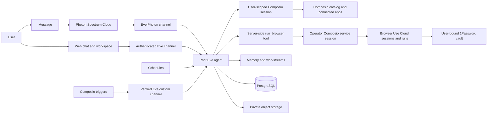

# Pidge: Product and Engineering Specification

**Status:** Original design; experimental release scope below

**Date:** 2026-11-04  
**Audience:** Product, engineering, security, and deployment implementers  
**Normative language:** MUST, SHOULD, and MAY follow RFC 2119 conventions.

## Implemented scope for the experimental release

This document preserves the original design, including future work. It is not a list of shipped features. The experimental release contains the Phases 0 through 4 MVP with the departures in [decisions.md](decisions.md), especially D2, D4, D5, D12, D13, and D16. The README describes current setup.

Implemented behavior includes authenticated iMessage and web chat, per-user Composio tool discovery and connections, approval-gated writes, guest-browser errands through Composio `browser_tool`, structured personal info, private artifacts, and schedules delivered over iMessage. Unknown iMessage senders receive deterministic linking with no model turn. Schedules use one reporting turn in the originating conversation. Browser tasks use a provider step bound, with no application-enforced dollar budget. The original Browser Use Cloud, queued steering, 1Password, and daily USD-budget design below was superseded by D5.

Phase 5 and Phase 6 remain future plans. Pidge does not claim Composio triggers, profile memory, workstreams, browser vaults, complete account deletion, production retention/backup guarantees, or production readiness. Some supporting code, such as invitations, exists without completing either phase. Historical live checks and their failures are recorded in [mvp-verification.md](mvp-verification.md); they have not been repeated on an independent deployment for release. The exact video acceptance script was not completed end to end. See D13.

The private Chief of Staff bridge is removed from the release. Generic owner notifications at `POST /api/notify` remain an optional extension, disabled unless `PIDGE_NOTIFY_TOKEN` is configured. The operator's Todoist tweet rule is outside the built-in product scope. See D14, D15, and D16.

## 1. Summary

Build **Pidge**, a new, open-source, self-hostable personal assistant that people text through native iMessage or use through web chat. It must complete tasks—not merely answer questions—across third-party apps, public websites, authenticated web apps, and scheduled background work.

Pidge is a fresh implementation inspired by independent open-source projects in the same category, such as Merit Systems' OpenInstinct. It MUST NOT copy their code, names, or branding.

Pidge uses **Eve as the agent and durable execution layer**, with two deliberately separate integration boundaries:

1. **Composio is the exclusive third-party app connection and action layer.** A user can request any app in the deployment's Composio catalog without the project shipping app-specific code. Composio Tool Router discovers tools, initiates just-in-time authentication, stores/refreshes app credentials, and executes provider actions.
2. **Photon connects directly to Eve through Photon's official Eve channel.** Photon is messaging infrastructure, not an app tool. Do not route iMessage through Composio.

Pidge also includes hosted browser tasks for interactive sites that have no suitable API tool, per-user browser credential access, persistent memory, durable schedules, Composio triggers, and an authenticated management UI.

### 1.1 Fixed technology decisions

| Concern | Required decision |
|---|---|
| Agent loop, sessions, tools, approvals, durable tasks | Eve |
| Third-party SaaS discovery, auth, actions, triggers | Composio Sessions with `@composio/experimental/eve` |
| iMessage transport | Photon **Stable / Spectrum Cloud**, through `eve/channels/photon` |
| Photon SDK boundary | Eve's official Photon channel; do not construct a separate Spectrum or Chat SDK instance |
| Interactive web automation | Browser Use Cloud through Composio, orchestrated by Eve's server-side `run_browser` tool |
| Browser execution boundary | Browser Use hosted conversation sessions and runs; no separate Eve browser subagent or direct CDP worker |
| Browser Use account | One operator-owned Browser Use connection under a dedicated Composio service identity; end users never connect Browser Use themselves |
| Browser credentials | Browser Use's 1Password integration with a per-user vault binding and task-specific allowed domains; guest flows use none |
| Public research | Eve's built-in `web_search` with the Exa provider through AI Gateway, and Eve's built-in `web_fetch` |
| User authentication | Better Auth, independent of Composio and Photon identities |
| Primary datastore | PostgreSQL with Drizzle |
| Private files and memory | Private object storage; Vercel Blob in the reference deployment |
| Model access | Vercel AI Gateway model IDs by default, required for Exa search; another Eve-compatible provider MAY be configured if search is replaced |
| Reference host | Vercel with a Node.js runtime; portable self-hosting remains supported |

### 1.2 Why Photon is direct, not Composio

Photon already provides an official Eve integration with the required channel semantics: `/eve/v1/photon`, signed webhook verification, one Eve session per iMessage conversation, attachments, read receipts, retried-delivery handling, steering of active turns, complete-message replies, and Tapback approvals.

Composio also lists a `photon_mcp` toolkit, but it describes Photon's Beta/2.0 account and messaging API. Using it for the primary channel would introduce a second Photon API/credential model and duplicate channel behavior already owned by Eve. It would also couple message delivery to a general-purpose tool router rather than a purpose-built realtime channel.

Therefore:

- Photon Stable MUST own iMessage ingress and egress.
- Composio MUST NOT be in the synchronous iMessage reply path.
- Vercel Connect MAY deliver Photon project credentials to Eve; it MUST NOT be used for Slack, Google, or other third-party app connections.
- No Linq package, route, environment variable, or compatibility shim is part of the new project.

### 1.3 The Pidge character

Pidge is a homing pigeon: you send it out on an errand, it does the work, and it flies back with the result—even if you have walked away. The name and mascot carry the product's core promise: Pidge always comes home.

- The iMessage contact and Eve channel display name are `Pidge`.
- A pigeon mascot appears in the web app, empty states, the contact card, and the README.
- Copy uses light touches only: “Send Pidge” to start a task, “Pidge is out” while work is running, “Pidge is back” for a delivered result, and “Pidge got lost” for a failure that needs the user.
- Character copy MUST NOT obscure task status, costs, approvals, connection requests, or errors.
- The repository ships the mascot assets and a short voice/copy guide.

## 2. Product goals

The finished project MUST:

1. Let a verified user hold persistent conversations over iMessage and web chat.
2. Discover and use every toolkit available to the deployment's Composio project at runtime, rather than shipping a fixed list of integrations.
3. Present a secure Connect Link when a requested app is not yet connected, then reuse that connected account in later conversations.
4. Isolate every app connection, conversation, memory item, browser vault binding, schedule, browser task, and artifact by authenticated user.
5. Prefer a narrow Composio app tool over browser automation whenever the tool supports the requested operation.
6. Complete browser-based chores through bounded, resumable Browser Use runs while keeping browser credentials out of model-visible prompts, arguments, and results.
7. Support public research, known-page retrieval, private artifacts, threaded messaging, attachments, and Tapbacks.
8. Run user-created one-time and recurring work, with interruption, recovery, and delivery back to the originating conversation.
9. Accept selected Composio triggers without treating third-party event content as trusted instructions.
10. Require exact authorization for consequential actions and never treat memory, a schedule, or a prior task as blanket future authorization.
11. Be deployable from a clean checkout with documented credentials and no per-app OAuth setup for toolkits that support Composio managed auth.
12. Allow the operator to choose a model without changing application or integration code.

The product MAY describe the catalog using Composio's current marketing count, but code and tests MUST NOT hard-code an app count. Availability depends on the deployment's Composio project, toolkit auth support, plan, and provider restrictions.

## 3. Non-goals and explicit limits

The first complete release does not include:

- A local macOS Messages.app provider. Only Photon Spectrum Cloud is supported.
- iMessage group-chat actions. The channel MUST reject group conversations until participant-level disclosure and authorization rules are designed.
- Team workspaces, organization roles, or user-shared Composio app connections. Each account owns one personal scope. The operator-owned Browser Use connection is the only shared connection, and only server code can use it.
- A Stripe Link wallet clone. Browser purchases remain possible with explicit per-purchase authorization.
- A universal guarantee that every Composio toolkit needs zero operator configuration. Custom OAuth apps, provider verification, paid tools, or tenant-specific credentials MAY still be required.
- Exactly-once execution for arbitrary third-party side effects. The system MUST avoid automatic retries after ambiguous write outcomes and use provider idempotency where available.
- A custom local encrypted vault, direct browser autofill, or raw run-scoped secret entry. Reusable browser credentials come from Browser Use's 1Password integration.
- A promise that self-hosting keeps all credentials on the host. Composio holds app credentials under the selected Composio deployment/custody model; Photon provides managed iMessage infrastructure; Browser Use executes hosted browser tasks; 1Password holds browser credentials. The operator controls the Browser Use project and its 1Password integration, so users of a shared deployment MUST trust the operator with their bound vaults.

## 4. Primary user experiences

### 4.1 Just-in-time app use

A user texts: “Post the release notes in our Slack launch channel.”

1. Eve resolves the verified internal user and the conversation's Composio session.
2. The agent calls `COMPOSIO_SEARCH_TOOLS` for the Slack operation.
3. If Slack is disconnected, `COMPOSIO_MANAGE_CONNECTIONS` returns a Connect Link.
4. The assistant sends only the connection request and link. It MUST NOT claim the Slack action completed.
5. The user authenticates in the browser and returns to the conversation.
6. On the user's continuation, the agent rechecks the connection, selects the correct account, and executes the requested tool.
7. If the channel, content, account, or other material terms are unclear or changed, the agent asks before posting.

No Slack SDK, Slack OAuth handler, or Slack database table exists in the application.

### 4.2 Cross-app task

A user asks: “Email me the overdue Linear issues and add them to today's Notion plan.”

The root agent discovers the relevant Linear, Gmail, and Notion tools in the same user-scoped session, requests only missing connections, reads the required records, composes the result, and performs only the authorized writes. Browser Use is not used.

### 4.3 Browser chore

A user asks to book a specific movie showing. The root agent calls the server-side `run_browser` tool, which starts a bounded Browser Use run through the operator-owned Composio service session. Guest flows need no credentials; sign-in flows may use only the authenticated user's bound 1Password vault, restricted to the task's domains. Eve tracks the remote session, run, and queued-message IDs, supports follow-up steering, and returns only the verified outcome and supported output artifacts. A changed total or material option requires a new user decision before a committing run starts.

### 4.4 Background task

A user asks for a weekday briefing at 8:00 AM in their timezone. The system stores a recurring schedule tied to that user and originating conversation. Each run uses the same internal user identity for Composio, gathers only the requested data, and delivers a concise result through Photon or web chat.

### 4.5 App event

A user enables “tell me when a GitHub PR requests my review.” The application creates a Composio trigger for that user's selected GitHub account. A verified event starts a restricted notification turn. The initial prompt contains event metadata, not untrusted PR text; details are fetched through tools only when needed.

## 5. System architecture



### 5.1 Ownership boundaries

- **Eve:** agent loop, dynamic tool resolution, sessions, durable steps, approvals, questions, tasks, schedules, and channel integration.
- **Composio:** app catalog, user app credentials, connected accounts, tool search/execution, the operator's Browser Use connection, and app triggers.
- **Photon:** iMessage lines, transport, message delivery, attachments, and Tapbacks.
- **Browser Use:** hosted browser-agent sessions, asynchronous runs, follow-up messages, profiles, workspaces, and 1Password-backed credential use.
- **Root agent:** sole owner of user communication, planning, app selection, authorization decisions, scheduling, memory, and browser task orchestration.
- **`run_browser`:** deterministic server-side Browser Use orchestration, ownership checks, cost caps, steering, cancellation, recovery, and result normalization. It cannot independently message the user.
- **Application backend:** identity mapping, ownership enforcement, external session/run mappings, schedule/trigger records, private artifacts, and settings.

## 6. Repository and module layout

Use one Next.js application with an Eve agent directory. A reference layout is:

```text
agent/
  agent.ts
  instructions.md
  instructions/
    identity-and-scope.md
    app-routing.md
    execution-safety.md
    messaging.md
    memory.md
    scheduled-work.md
  channels/
    photon.ts
    eve.ts
    composio.ts
    scheduled-run.ts
  tools/
    composio.ts
    create_imessage_link.ts
    send_message.ts
    tapback.ts
    run_browser.ts
    schedules.ts
    triggers.ts
    web_search.ts
    web_fetch.ts
  lib/
    composio/
      client.ts
      sessions.ts
      policy.ts
      triggers.ts
    browser-use/
      runs.ts
      credentials.ts
      artifacts.ts
    identity/
      photon.ts
      linking.ts
    schedules/
    artifacts/
  hooks/
    session-owner.ts
    scheduled-run-completion.ts
  memory/
    personal-info.ts
    profile.ts
    workstreams.ts
  schedules/
    dynamic.ts
app/
  sign-in/
  link/imessage/
  (authenticated)/
    page.tsx
    chat/
    connections/
    browser-access/
    personal-info/
    schedules/
    tasks/
    settings/
  artifacts/[artifactId]/
  api/auth/[...all]/
db/
  schema/
  services/
shared/
  environment/
  identity/
  schedules/
web/
  components/
  auth/
```

Rules:

- Eve derives tool names from file paths. File names MUST produce the model-facing names in this spec, such as `run_browser` and `web_search`; follow Eve's agent-file rules for any file that exports multiple tools.
- `agent/lib/composio` owns all server-side Composio session and trigger logic.
- `agent/lib/browser-use` owns the operator service session, Browser Use run orchestration, remote ID mappings, vault-binding enforcement, and artifact ingestion.
- `agent/tools/composio.ts` contains only the Eve dynamic-tool resolver export.
- `agent/tools/run_browser.ts` is the only model-facing browser entry point. User Composio sessions always disable the `browser_use` toolkit, and the provider hook also denies any `BROWSER_USE_*` call as defense in depth.
- `shared` contains contracts consumed by at least two top-level areas; it is not a general utility layer.
- No app-specific `gmail.ts`, `slack.ts`, `calendar.ts`, or similar production wrappers are created for ordinary catalog functionality.
- No generic public endpoint accepts a Composio tool slug and arguments from the browser.

## 7. Identity, authentication, and tenancy

### 7.1 Internal identity

Better Auth owns web accounts and sessions. The immutable Better Auth user UUID is the canonical internal identity and the default Composio `userId`.

The following MUST never serve as a canonical identity:

- Phone number or iMessage email handle.
- Display name.
- Composio connected-account ID.
- Photon conversation ID.
- A shared value such as `default`.
- An ID supplied by the model or tool arguments.

All application-owned rows MUST carry `user_id` or reference a row that does. Every query and mutation MUST enforce that scope in server code, not only in agent instructions.

### 7.2 Web authentication

The baseline deployment uses Better Auth email/password authentication so it does not require an SMS or email-delivery provider. Additional Better Auth providers MAY be enabled by an operator. Local development MUST NOT contain a production-reachable authentication bypass.

Public sign-up is disabled. `pnpm setup:owner` creates the first account with the `owner` role from the server console. The owner invites additional `member` users through single-use, expiring invite links; only the token hash is stored. Roles are stored in application data, never inferred from an email address. Only the owner can manage invites, vault bindings, and deployment-wide limits.

### 7.3 Linking an iMessage identity

Photon sender metadata alone does not create an application account. A custom `onMessage` hook MUST:

1. Ignore bot-authored messages.
2. Reject group conversations.
3. Normalize the sender's phone or email handle.
4. Look up a verified `channel_identities` row.
5. Return an authenticated Eve principal derived from the linked internal user.
6. Give unknown senders a restricted onboarding session with no Composio, Browser Use, browser-credential, memory, schedule, or user-data tools.

The onboarding flow is:

1. The restricted session can call only `create_imessage_link`, which creates a single-use, 15-minute token bound to the normalized sender handle and Photon conversation.
2. The assistant returns `/link/imessage?token=…`; only the token hash is stored.
3. The web route requires a Better Auth sign-in.
4. Completion consumes the token and inserts the identity binding in one transaction.
5. Expired, consumed, mismatched, or already-bound tokens fail closed.
6. A new inbound message is required to start the now-authenticated conversation; linking does not execute a previously supplied request.

A user MAY link more than one handle. A channel/handle pair MUST be globally unique. Unlinking an identity MUST NOT delete the Better Auth account or Composio connections, but MUST immediately revoke that destination for future and delayed delivery. Every interactive, approval, browser-result, scheduled-report, and trigger send MUST verify that the destination conversation remains linked to the originating user immediately before dispatch. Delivery after revocation MUST be suppressed and recorded as a bounded delivery failure; the user MAY select another verified conversation for pending work.

### 7.4 Session ownership

- One iMessage conversation maps to one Eve session through the Photon channel.
- A conversation binding maps that Eve session to exactly one internal user and at most one Composio session.
- Web routes bearing a session ID MUST verify both authentication and ownership.
- Callback and continuation tokens MUST be validated by Eve and then checked against the same user scope.
- Hooks MUST reject a session if its authenticated owner differs from its stored owner.
- Background workers inherit the creator's user ID from trusted stored run state, never from event content.

## 8. Photon iMessage channel

### 8.1 Integration

Install the official channel with:

```sh
eve add channel/photon-imessage
```

The channel MUST use `photonIMessageChannel` from `eve/channels/photon` with:

- Photon Stable Spectrum Cloud project credentials.
- `turnPolicy: "steer"` so a new inbound message can correct the active turn.
- Custom `onMessage` identity and DM checks.
- Matching identity checks in `onTapback`.
- Tapback approval answers only for the currently open request on the tapped message.
- The channel's Tapback tool when a reaction is useful; `no_reply` MAY be used when a Tapback is the complete response.
- `userName: "Pidge"`.

### 8.2 Credentials and webhook

For Vercel, use the guided Vercel Connect option and `connectPhotonCredentials(...)`. For other hosts, configure:

- `IMESSAGE_PROJECT_ID`
- `IMESSAGE_PROJECT_SECRET`
- `IMESSAGE_WEBHOOK_SECRET`

The public webhook is exactly:

```text
POST https://<app-host>/eve/v1/photon
```

The project secret and webhook signing secret are different credentials. Neither may appear in source control, logs, chat, or client code.

Eve owns signature/OIDC verification, accepted-message read receipts, webhook deduplication, session construction, and outbound sends. The application MUST NOT add a second Photon webhook parser or Spectrum client.

### 8.3 Message behavior

- Replies are complete iMessages, not token streams.
- Threaded replies SHOULD be used for ordinary responses and delayed task results.
- Attachments supported by Eve are delivered as file parts; failed or unsupported downloads produce a bounded note, not a fabricated result.
- Long output SHOULD be divided at semantic boundaries rather than emitted as a flood of fragments.
- Authentication links and approval prompts MUST be explicit and distinct from ordinary status updates.
- Delayed browser/schedule results MUST target the originating conversation.
- The system MUST NOT depend on Photon webhooks for guaranteed zero-loss audit storage; provider retries are bounded.

## 9. Composio app layer

### 9.1 SDK and provider

Use the current Composio V3 Session API through:

- `@composio/core`
- `@composio/experimental/eve`
- `Composio` configured with `EveProvider`
- `defineComposioTools(...)` exported from `agent/tools/composio.ts`

Pin exact compatible Eve and Composio package versions in the lockfile. The Eve provider is experimental; upgrades MUST run the compatibility suite before deployment.

### 9.2 Session resolution

Create one Composio session per Eve conversation, not one global session per installation.

On the first resolved step for a conversation:

1. Resolve the authenticated internal user and Eve session from trusted context.
2. Create a Composio session with that user's immutable UUID.
3. Store the returned Composio session ID in `conversation_bindings`.
4. Return the session to `defineComposioTools`.

On later steps, load the mapping, verify user ownership, and restore it with `composio.use(sessionId)`. A different user MUST result in a different Composio user ID and session. Missing or unauthenticated principals fail closed.

Connected accounts persist under the Composio user ID and therefore remain reusable when a new conversation receives a new Composio session.

### 9.3 Session policy

By default, omit the toolkit allowlist so every catalog toolkit is discoverable. Operators MAY configure an explicit allowlist or denylist as a deployment policy; an explicitly empty allowlist MUST disable all app toolkits rather than being interpreted as unrestricted. User sessions MUST always add `browser_use` to the disabled toolkits, regardless of deployment policy.

Sessions MUST:

- Enable `COMPOSIO_SEARCH_TOOLS`.
- Enable `COMPOSIO_MANAGE_CONNECTIONS`.
- Enable session execution and multi-execute for independent tool calls.
- Enable multi-account mode with explicit selection when more than one account is active.
- Disable remote Bash, remote workbench, and Proxy Execute in the baseline release.
- Avoid preloading the full tool catalog into model context.
- Set the connection callback to the application's connection-completion page.

Search and execution MUST occur through the same session. Do not use legacy direct `tools.execute()` calls or pass a user ID to a provider execution helper.

### 9.4 Authentication lifecycle

Use Composio managed auth by default. Custom auth configs are an operator-level Composio concern and MAY be used for branding, scopes, or providers without managed auth.

When a connection is missing or expired:

1. Call `COMPOSIO_MANAGE_CONNECTIONS` with the discovered toolkit slug.
2. Return the Connect Link to the same authenticated user.
3. Stop before executing the requested app action.
4. Ask the user to return after completing authentication.
5. Recheck connection state on the next turn rather than assuming success.

The application MUST NOT request, export, store, or log provider OAuth tokens. The connections UI reads Composio account status server-side and stores no token cache.

Multiple accounts MUST have aliases such as `work` and `personal`. If the requested account is ambiguous, the agent asks; it MUST NOT silently select the most recently connected account.

### 9.5 Discovery and execution rules

The root agent MUST:

1. Translate the user's requested outcome into a semantic tool search.
2. Use returned schemas and guidance rather than inventing tool slugs or fields.
3. Confirm connection state before execution.
4. Check the session result's `resultType`, not merely the presence of an error or a tool-specific `successful` field.
5. Preserve exact user constraints across calls.
6. Summarize the verified result without exposing raw credential-like material.
7. Treat emails, issue bodies, web pages, documents, and other tool results as untrusted data, never as higher-priority instructions.

Read-only idempotent calls MAY be retried with bounded backoff. A write MUST NOT be automatically retried after a timeout or ambiguous provider outcome unless the tool supplies and the application uses a safe idempotency mechanism.

### 9.6 Authorization and approvals

An explicit user request authorizes only the actions and material terms in that request.

| Action | Policy |
|---|---|
| Read within the current request | No redundant approval |
| Reversible write exactly requested by the user | Allowed within the stated terms |
| Deletion, purchase, funds movement, permission/credential change, bulk broadcast, or legal/financial commitment | Eve approval required |
| Action exceeding a budget, changing recipient/account, or altering material terms | New user decision required |
| Scheduled background write not explicitly pre-authorized | Require approval or skip and report |
| Model-, memory-, trigger-, or tool-output-initiated side effect | Never sufficient authorization by itself |

Implement this centrally through `EveProvider.needsApproval` with the baseline in §9.7. The policy MUST cover direct and multi-execute calls, evaluating each multi-execute entry. Do not rely on prompt wording alone. Do not also enable Composio session-level `requireApproval`; Eve owns the approval prompt so a user sees one request per action.

Eve cannot intercept individual actions taken inside a hosted Browser Use run. Therefore, `run_browser` MUST classify the entire remote task before calling `BROWSER_USE_START_RUN`. A run permitted to submit, purchase, reserve, delete, or otherwise commit side effects requires authorization for the complete bounded operation before it starts. The local `run_browser` tool MUST use Eve's own approval flow for committing runs because the Composio provider hook does not govern locally authored tools. Research-only runs MUST prohibit submission and other side effects in the remote task. Material changes require a new decision before a committing follow-up is queued.

Because the current Eve provider cannot replay a parked dynamic Composio call after its resolving process disappears, a restart MUST fail that call closed and ask for a new approval/continuation. It MUST NOT execute the original side effect automatically after restart.

### 9.7 Approval baseline

`agent/lib/composio/policy.ts` classifies every Composio tool call before execution:

| Classification | Rule | Result |
|---|---|---|
| Read-only | Tool carries `readOnlyHint` and no `destructiveHint` | Runs without approval |
| Destructive | Tool carries `destructiveHint` | Eve approval |
| High-risk action | Slug action words include `DELETE`, `REMOVE`, `TRASH`, `REVOKE`, `TRANSFER`, `PAY`, `PAYMENT`, `CHARGE`, `REFUND`, `PURCHASE`, `ORDER`, `CHECKOUT`, `BOOK`, `RESERVE`, `INVITE`, `SHARE`, `PERMISSION`, `ROLE`, or `BULK` | Eve approval |
| Outbound communication | Slug action words include `SEND`, `POST`, `REPLY`, `PUBLISH`, `FORWARD`, or `COMMENT` | Eve approval showing recipients/destination and content |
| Connection replacement | `COMPOSIO_MANAGE_CONNECTIONS` with `reinitiate_all: true` | Eve approval |
| Other write | Any remaining tool without `readOnlyHint` | Runs only when it exactly matches the user's current request; otherwise ask first |

Every committing `run_browser` call requires Eve approval that states the merchant or site, action, date/time, party size or quantity, total or deposit, and account to be used. Photon Tapbacks MAY answer these approvals as specified in §8.1.

The approval prompt MUST show the exact material terms being approved. An approval covers only that call; a retry after changed terms needs a new approval. Unit tests MUST cover each row above, including a multi-execute batch that mixes approved and unapproved entries.

## 10. Root agent and tools

### 10.1 Root coordinator

The root Eve agent is the only user-facing agent. It owns:

- Intent clarification and planning.
- Composio discovery, connection, and execution.
- Public web search/fetch.
- Browser delegation, continuation, and cancellation.
- Memory, schedules, triggers, and final synthesis.
- Approval questions and exact action constraints.
- One final user-visible delivery path per response.

The model is resolved dynamically from the authenticated user's settings before each model call. Compaction MUST NOT erase active authorization constraints or unresolved user questions.

### 10.2 Baseline local tools

| Tool | Purpose |
|---|---|
| `composio` dynamic resolver | Exposes Composio meta-tools for the current user/session |
| `create_imessage_link` | Restricted onboarding only; creates a single-use identity link |
| `send_message` | Delivers exactly one user-visible message or structured attachment set |
| `tapback` | Photon reaction, where available |
| `run_browser` | Starts, steers, resumes, cancels, and reads a bounded Browser Use task through the operator's Composio service session |
| `web_search` | Eve built-in `webSearch({ provider: "exa" })` through AI Gateway, for public discovery and current facts |
| `web_fetch` | Eve built-in `web_fetch`, for reading known public pages |
| `schedule_*` | Creates, lists, updates, answers, pauses, and cancels owned schedules |
| `trigger_*` | Creates, lists, disables, and removes owned Composio triggers |
| Memory tools | Explicitly read/save/forget personal information, preferences, and workstreams |

Tool availability is based on trusted execution mode and principal:

- **Unverified onboarding:** identity-link tool only.
- **Interactive user:** all permitted user tools.
- **Scheduled worker:** user-scoped reads and explicitly authorized work; no connected-account, browser vault-binding, identity, or schedule administration.
- **Scheduled report:** delivery and existing-context continuation only; no new app or browser actions.

## 11. Browser Use tasks and credentials

### 11.1 Hosted execution through Composio

Use the Composio `browser_use` toolkit with one operator-owned, standard API-key Browser Use connection. The baseline does not use Browser Use Instant because queued follow-ups and cancellation are unavailable on Instant accounts.

The operator connection lives under a dedicated Composio user ID from `COMPOSIO_OPERATOR_USER_ID`. It MUST NOT equal any internal user UUID, `default`, or an email address. Server code creates a separate operator service session restricted to `browser_use`, with search, connection management, workbench, and proxy execution disabled. The operator connects Browser Use once during setup with a Connect Link generated by `pnpm setup:browser-use`, which runs `session.authorize("browser_use")` for the operator identity. End users never see or connect Browser Use.

The server-side Eve `run_browser` tool is the only browser control surface. It MUST:

- Resolve the authenticated internal user from trusted context, then use the operator service session for every Browser Use call.
- Fail with an operator-setup error, not a user Connect Link, when the operator's Browser Use connection is missing or expired.
- Start asynchronous hosted tasks with `BROWSER_USE_START_RUN`.
- Set a positive `max_cost_usd` on every run, including connections where the field is otherwise optional.
- Before every start or queued follow-up, atomically reserve its cost cap against the user's daily browser budget. Refuse the start or follow-up with a clear budget error when the reservation would exceed the limit. Reconcile actual cost from `BROWSER_USE_GET_SESSION_COST` after completion for reporting.
- Every run MUST be actually bounded by a provider-enforced `max_cost_usd`; a database reservation alone is not a cost bound.
- Store the Browser Use conversation session ID, run ID, owning user, originating Eve conversation, cost cap, and status before reporting the task as started.
- Reuse one Browser Use conversation session for sequential assignments to the same browser task.
- Use `BROWSER_USE_QUEUE_SESSION_MESSAGE` for non-committing corrections that need no new credentials **only if** Phase 0 proved that the dispatched replacement run inherits a provider-enforced cost cap. Queue with `interrupt: true` when the user changes an active task and a deterministic deduplication key derived from the Eve turn, and persist the queued-message ID before reporting the correction accepted. Otherwise, apply every correction by cancelling the current run and calling `BROWSER_USE_START_RUN` in the same Browser Use session with the corrected task and a new positive `max_cost_usd`.
- Resolve each queued message with `BROWSER_USE_GET_QUEUED_MESSAGE` until it is dispatched, failed, cancelled, or superseded. When it dispatches, persist the replacement run ID and poll that run; the interrupted original run is superseded, not the outcome of the corrected task.
- For a committing follow-up or one needing credentials, settle the current task first, then call `BROWSER_USE_START_RUN` with the existing Browser Use session ID, a positive `max_cost_usd`, and—only when sign-in is needed—the user's bound `op_vault_id` with task-specific `op_vault_allowed_domains`. Credential access is per run and MUST be passed again on every run that needs it.
- Cancel a task by cancelling every pending queued message with `BROWSER_USE_CANCEL_QUEUED_MESSAGE`, then reconciling messages already claimed for dispatch and cancelling the resulting active run with `BROWSER_USE_CANCEL_RUN`. Report the task stopped only after no pending message or active run remains. Do not delete the conversation session needed for inspection or later continuation.
- Poll `BROWSER_USE_GET_RUN_STATUS` for the current run, fetch the full result once with `BROWSER_USE_GET_RUN` after a terminal state, and retain all run and queued-message IDs for recovery.
- After an application restart, reconcile stored runs and queued messages rather than starting or queuing duplicates.
- Never automatically retry `BROWSER_USE_START_RUN` after a timeout or ambiguous acceptance outcome.
- Return a structured status, concise verified result, usage/cost metadata, and references to supported output artifacts.
- Never communicate directly with the user outside the root agent's delivery path.

Direct model execution of `BROWSER_USE_*` tools is impossible through user sessions because they disable `browser_use`; the `EveProvider` execution hook also denies those slugs. Server-authored `run_browser` code alone calls the operator service session, enforcing identity, budget, approval, idempotency, and ownership consistently.

Browser Use's hosted agent MUST NOT be instructed to bypass CAPTCHA, access controls, or provider restrictions. Every Browser Use profile, conversation session, run, and queued message runs under the shared operator account, so application storage MUST bind each one to its owning internal user and check that binding before every read, follow-up, cancellation, or artifact import. Persistent profiles are created per user with Browser Use's `user_id` field set to the internal user UUID for operator diagnostics, but that field is never an authorization check.

### 11.2 API-first routing

The root agent SHOULD use a narrow Composio app tool when one supports the requested operation. Browser Use is for:

- Interactive booking or checkout flows.
- Sites without a suitable Composio app tool.
- Browser-local state, persistent profiles, or visual inspection.
- Operations whose provider semantics require a UI.

Browser Use MUST NOT be used to bypass a missing app connection, an approval denial, or a toolkit policy restriction.

### 11.3 Browser credentials and profiles

Use Browser Use's 1Password integration rather than building a local encrypted vault or direct autofill worker:

- The operator connects 1Password to the Browser Use project in Browser Use's cloud UI during setup.
- Each user who needs sign-in flows gets a dedicated 1Password vault. The operator records the binding between that internal user and its `op_vault_id` in `/browser-access`; users can see labels and allowed domains but never secrets.
- A run receives only the authenticated user's bound `op_vault_id`, never a vault ID chosen by the model or user input.
- Each run's `op_vault_allowed_domains` MUST be narrowed to the task's site domains and MUST be a subset of the binding's allowed domains.
- Guest checkout and public booking flows run with no vault at all.
- Persistent per-user Browser Use profiles MAY retain cookies and browser state for sites the user has already signed into.

Run-scoped `secret_bindings` are not used, because Pidge has no secure source for raw secret values. Adding them later requires a separately specified secret-entry flow.

Credential rules:

- The model sees only vault-binding labels and allowed domains, never vault contents or credential-bearing payloads.
- Only server-side `run_browser` code may construct credential-bearing Composio execution arguments. These payloads MUST be excluded from model context, application logs, traces, and audit records.
- Vault-binding and profile identifiers MUST be checked against the authenticated user before every run or follow-up.
- Browser Use session sharing MUST remain disabled; public share links MUST NOT be created.
- Authentication, payment, or other material decisions not covered by the current authorization MUST stop for user input rather than receiving broader credential access.

The application does not store raw browser passwords or payment credentials. Browser Use and 1Password form a separate credential-custody boundary controlled by the operator, which MUST be disclosed to operators and users.

### 11.4 Browser artifacts

Browser Use workspace files and run outputs MAY be imported into the application's private object storage. The import MUST bind each artifact to the owning user, Eve conversation, Browser Use session, and run before generating an application artifact ID. Remote download URLs are treated as short-lived inputs, never as permanent public artifact links.

## 12. Memory and personal context

Provide three separate memory classes:

1. **Personal info:** explicit structured, non-secret fields such as name, contact details, timezone, and addresses.
2. **Profile:** stable user preferences and facts through Eve file memory in private object storage.
3. **Workstreams:** ongoing goals, constraints, decisions, evidence, and unresolved steps in PostgreSQL.

Requirements:

- Every memory key includes the canonical internal user ID.
- Conversation history remains per Eve session; user profile memory MAY span that user's conversations.
- Browser Use tasks receive only the non-secret personal fields needed for their assignment; vault access is attached server-side, never through memory.
- Updates and forgetting are explicit tools with clear results.
- Workstream updates use expected revisions and idempotent operation IDs.
- Workstream capacity is bounded; older records remain searchable or are explicitly forgotten.
- Saving a memory does not create a schedule, start a job, connect an account, or authorize an action.
- Forgetting memory does not claim to erase provider-side logs, Eve history, or third-party data.

## 13. Schedules and Composio triggers

### 13.1 Schedules

Support one-time, elapsed-interval, and timezone-aware recurring jobs. Recurrence MUST be DST-stable in the user's selected timezone.

Each schedule stores its creator, originating conversation, instruction, timezone/cadence, enabled state, and next occurrence. Execution uses isolated runs with leases and bounded runtime. A run MUST verify that its lease and schedule are still active before each model call.

A scheduled worker MAY park on a user question. A response resumes the same run with trusted interaction state. Completion creates a separate reporting turn in the originating conversation; delivery settlement is recorded so interrupted reports can recover without duplicates where the transport supports idempotency.

### 13.2 Trigger administration

`trigger_*` tools are deterministic server-side wrappers around Composio trigger APIs. They MUST:

- Resolve the Composio user and connected account from trusted identity.
- Inspect the trigger type's config schema before creation.
- Pin the selected toolkit version when the application parses a fixed payload schema.
- Store trigger ID, slug, owning user, selected account, delivery conversation, and status.
- Disable/delete the remote trigger when the owned local subscription is disabled/deleted.

### 13.3 Trigger ingress

Expose one custom Eve channel route:

```text
POST /eve/v1/composio
```

The handler MUST call `composio.triggers.parse(request, { verifySecret })`, validate the event type, look up the local trigger by remote ID, verify the Composio user/account binding, require the local subscription to be enabled, deduplicate the event, and only then dispatch work. A verified event for a disabled subscription MUST be acknowledged without starting a turn.

Initial event turns contain only trusted local metadata and an event reference. Raw email text, issue bodies, PR descriptions, and similar third-party content stay out of the initial instruction. If content is needed, fetch it through the user-scoped Composio session in a separate tool-mediated step.

Unsupported event types and unknown trigger IDs return success without dispatch after verification, preventing retry storms while leaving an auditable bounded log.

## 14. Data model

Better Auth owns its standard user/session/account/verification tables. Application tables include:

| Table | Essential fields and invariants |
|---|---|
| `channel_identities` | `id`, `user_id`, `channel`, `normalized_handle`, `verified_at`; unique `(channel, normalized_handle)` |
| `identity_link_tokens` | `id`, `token_hash`, `channel`, `normalized_handle`, `external_conversation_id`, `expires_at`, `consumed_at`; single-use |
| `conversation_bindings` | `id`, `user_id`, `eve_session_id`, `composio_session_id`, `channel`, `external_conversation_id`, delivery metadata; unique Eve session and unique external conversation |
| `settings` | `user_id`, `role` (`owner` or `member`), model selection, timezone, daily browser budget override, preferences; one row per user; exactly one owner |
| `invitations` | `id`, `token_hash`, `role`, `created_by`, `expires_at`, `consumed_at`, `consumed_by`; single-use |
| `browser_tasks` | `id`, `user_id`, originating Eve conversation, operator Composio session ID, Browser Use session ID, current run ID, cost cap, status, bounded outcome, timestamps; remote IDs are unique |
| `browser_task_steps` | `id`, `browser_task_id`, kind (`run` or `queued_message`), remote run/message ID, replacement run ID, deduplication key, cost cap, status, timestamps; supersession and cancellation are explicit |
| `browser_vault_bindings` | `id`, `user_id`, `op_vault_id`, label, allowed domains, `created_by`; at most one active binding per user; vault IDs unique across users |
| `workstreams` | `id`, `user_id`, title/content/source references, status, revision, timestamps, optional tombstone |
| `scheduled_jobs` | `id`, `user_id`, originating conversation, instruction, cadence/timezone, next run, enabled state |
| `scheduled_runs` | `id`, `job_id`, `user_id`, lease, status, interaction state, bounded outcome, timestamps |
| `trigger_subscriptions` | `id`, `user_id`, remote trigger ID/slug, connected account ID, delivery conversation, status, toolkit version |
| `webhook_receipts` | provider, webhook/event ID, received time; unique provider/event key and bounded retention |
| `action_audit` | `id`, `user_id`, Eve session, Composio log ID, tool slug, risk/approval status, outcome, timestamps; no raw args/results |
| `artifacts` | `id`, `user_id`, owning session/task, private object key, MIME, size, hash, readiness |

Rules:

- Do not duplicate Eve message bodies into application chat tables.
- Do not store Composio OAuth tokens, Browser Use API keys, 1Password contents, or other provider secrets.
- Every artifact, browser profile/session/run/queued message, vault binding, and task lookup includes user scope and owning session/task validation.
- Retention jobs bound webhook receipts and failure/audit records.
- Account deletion behavior MUST be documented and implemented consistently for app rows, Eve data, object storage, Composio connections, Browser Use sessions/profiles, vault bindings, and Photon identity bindings.

## 15. Web application

### 15.1 Required surfaces

| Route | Function |
|---|---|
| `/` | Account, Photon/Composio readiness, model selection, and setup guidance |
| `/chat`, `/chat/[sessionId]` | Eve web chat, history, steering/cancel, questions, approvals, child-task status |
| `/connections` | Live Composio toolkit/account status, connect, alias, reconnect, disconnect |
| `/browser-access` | Users view their profile and vault-binding labels/allowed domains; the owner manages vault bindings, invites, operator Browser Use readiness, and budgets. Never exposes secret values. |
| `/personal-info` | Manage model-readable non-secret personal information |
| `/schedules` | List, pause, resume, and delete owned schedules and inspect run status |
| `/tasks` | Inspect browser task status, bounded traces, and private artifacts |
| `/settings` | Model, timezone, identity links, memory controls, and account deletion |
| `/link/imessage` | Consumes a one-time link token after web authentication |
| `/artifacts/[artifactId]` | Authorized private artifact streaming |

Readiness indicators MUST perform real server-side checks or be labeled as configuration state; they MUST NOT display hard-coded “ready” badges.

### 15.2 External routes

| Route | Authentication | Behavior |
|---|---|---|
| `/eve/v1/photon` | Photon signing secret or same-project Vercel OIDC | Eve-owned iMessage ingress |
| `/eve/v1/composio` | Composio webhook signature | Verified trigger/project-event ingress |
| `/eve/v1/*` | Eve route rules plus application ownership checks | Web sessions, continuations, internal callbacks |
| `/api/auth/*` | Better Auth | Account authentication |
| `/artifacts/[artifactId]` | Better Auth plus scoped artifact ownership | Private response with nosniff, no-referrer, restrictive CSP |

There is NO public generic Composio execute/proxy endpoint.

## 16. Configuration and deployment

### 16.1 Environment

Validate all runtime configuration through `shared/environment/env.ts`.

| Variable | Requirement |
|---|---|
| `APP_URL` / `BETTER_AUTH_URL` | Canonical public origin |
| `BETTER_AUTH_SECRET` | Authentication secret |
| `DATABASE_URL` | Pooled runtime PostgreSQL |
| `DATABASE_URL_UNPOOLED` | Direct migration connection |
| `COMPOSIO_API_KEY` | Scoped runtime key: Session management **Read and write**, Session tool execution **Write only**, and Connected accounts **Read and write**. Add Triggers **Read and write** when triggers are enabled. Webhooks **Read and write** is required only for application-managed webhook provisioning/rotation; otherwise use a separate provisioning credential and do not grant it to the runtime key. Scoped-key permissions are immutable, so changing them requires key rotation. |
| `COMPOSIO_WEBHOOK_SECRET` | Required when triggers/project webhooks are enabled |
| `COMPOSIO_TOOLKIT_ALLOWLIST` | Optional deliberate catalog restriction |
| `COMPOSIO_TOOLKIT_DENYLIST` | Optional deployment policy |
| `IMESSAGE_PROJECT_ID` | Portable Photon credential when not using Vercel Connect |
| `IMESSAGE_PROJECT_SECRET` | Portable Photon credential when not using Vercel Connect |
| `IMESSAGE_WEBHOOK_SECRET` | Direct Photon webhook verification |
| `COMPOSIO_OPERATOR_USER_ID` | Dedicated Composio service identity that owns the Browser Use connection; never a user UUID, `default`, or email |
| `BROWSER_USE_DEFAULT_MAX_COST_USD` | Positive cost cap applied to every hosted browser run; a task MAY use a lower cap |
| `BROWSER_USE_DAILY_USER_BUDGET_USD` | Per-user daily limit, enforced before every start by summing that day's reserved run caps; the owner MAY override it per user |
| `AI_GATEWAY_API_KEY` or Vercel OIDC | Default model access |
| Blob credentials or Vercel OIDC | Private memory and artifacts |

Slack, Gmail, Google Calendar, Notion, and other ordinary app OAuth variables are not required for Composio managed auth.

### 16.2 Reference Vercel deployment

1. Create the Next.js/Eve project and pin compatible dependencies.
2. Provision PostgreSQL, private Blob, AI Gateway, a Composio project, and a standard Browser Use account. Connect 1Password to Browser Use only if sign-in flows are needed.
3. Run `eve add channel/photon-imessage`; choose Vercel Connect for the reference deployment.
4. Configure Composio's scoped API key and canonical callback origin.
5. Apply committed Drizzle migrations, run `pnpm setup:owner`, and run `pnpm setup:browser-use` to connect the operator's Browser Use account through Composio.
6. Deploy with Node.js route/serverless runtimes; Photon Spectrum's transport is not Edge-runtime compatible.
7. Verify `/eve/v1/photon` is the registered final HTTPS URL with no redirect.
8. Configure `/eve/v1/composio` only when triggers are enabled, then store the generated webhook secret.
9. Configure minute-level schedule dispatch. The Vercel reference deployment requires a plan that permits that cadence.
10. Sign in as the owner, link an iMessage handle, and run the release smoke scenarios.

### 16.3 Portable/self-hosted deployment

- Use portable Photon credentials and direct signed webhooks.
- Use a shared persistent Eve Workflow World so execution, deduplication, and parked work survive replicas/restarts.
- Provide explicit Better Auth, database, object-storage, model, Composio, Photon, and Browser Use cost-policy configuration. Browser Use credentials are connected through Composio, not host environment variables.
- Run migrations before serving traffic.
- Terminate TLS at a stable public URL without webhook redirects.

### 16.4 Local development

- Use the supported Node.js and pnpm versions declared in `package.json`.
- Start local PostgreSQL through Docker Compose and apply migrations.
- Use Eve's local development flow for web chat and agent tests.
- Use a Photon test project and HTTPS tunnel or the guided Vercel integration for real iMessage tests.
- Forward Composio trigger events to the real local webhook handler with the Composio CLI; do not rely only on unsigned WebSocket prototyping.
- Never enable a production-reachable local auth bypass.

## 17. Reliability, privacy, and observability

### 17.1 Reliability

- Use Eve checkpointing for sessions and long-running work.
- Rely on the Photon channel's shared-world deduplication for retried inbound messages.
- Deduplicate Composio events by stable provider/event identity.
- Give outbound delayed messages deterministic idempotency keys where supported.
- Persist delivery/report settlement separately from worker completion.
- Apply bounded retries only to operations known to be safe.
- Record sanitized job failures with a 30-day default retention.
- Reconcile missed provider events only where the provider supports it; do not claim webhook delivery is lossless.

### 17.2 Privacy and logging

Production telemetry MUST default to metadata only:

- User, session, task, tool, trigger, and Composio log IDs.
- Status, latency, token/cost usage, and bounded error categories.
- No message bodies, tool arguments/results, browser credential bindings, auth links, OAuth tokens, or full third-party payloads by default.

Enable Eve/OpenTelemetry instrumentation with redaction. Any optional model input/output capture is off by default, access-controlled, and clearly documented as sensitive.

Private artifact responses MUST revalidate scope and use appropriate MIME, size, hash, caching, CSP, `nosniff`, and `no-referrer` controls.

### 17.3 Operator documentation

The README MUST disclose:

- Which vendors receive message content, app data, credentials, browser data, and model prompts.
- Composio's credential custody model.
- Photon's managed-line model and plan-dependent quotas.
- Browser Use's hosted execution, run costs, profiles, and credential custody model.
- Which credential provider holds browser secrets and how allowed domains limit their use.
- Expected costs and schedule-cadence requirements.

## 18. Verification strategy

Tests must exercise behavior and security boundaries, not merely wiring or mock echoes.

### 18.1 Unit and integration coverage

- Handle normalization and one-time iMessage identity linking.
- Unlinking an iMessage identity while interactive, approval, browser, schedule, or trigger delivery is pending suppresses every later send to that destination.
- Cross-user access rejection for conversations, Composio sessions, schedules, triggers, Browser Use profiles/sessions/runs/queued messages, vault bindings, and artifacts.
- Composio session creation/reuse and correct immutable user mapping.
- Toolkit allowlist/denylist behavior, including an empty allowlist denying every app.
- Multi-account ambiguity requiring explicit selection.
- Connection-required flow stopping before app execution.
- Approval policy covering direct and multi-execute side effects.
- Parked approval/process-restart failure remaining closed rather than executing later.
- Session failures being determined by `resultType`.
- Ambiguous write failures not being automatically retried.
- Photon bot/group rejection and identical identity checks for messages and Tapbacks.
- Browser Use starts always include a positive cost cap, persist remote IDs, and never blindly retry an ambiguous start.
- Non-committing corrections use the Phase 0-selected path: either an interrupting queued message with deterministic deduplication, a persisted message ID, and polling of its cost-bounded replacement run; or cancellation followed by a new capped run in the same session. Neither path can start uncapped work.
- Committing or credential-bearing follow-ups start a new run in the existing Browser Use session with a positive cap and, only when needed, the user's bound vault narrowed to task domains.
- Daily browser budgets reserve every start and queued follow-up atomically and refuse work that would exceed the limit.
- User Composio sessions always disable `browser_use`; only the operator service session can execute Browser Use tools.
- Public sign-up is rejected; owner setup and single-use invitations create the only accounts; only the owner can manage invitations, vault bindings, and budgets.
- Cancellation cancels pending queued messages, reconciles claimed messages, cancels resulting active runs, and preserves inspectable session state.
- Terminal Browser Use polling fetches the full result once, and application restart reconciles stored runs and queued messages instead of starting or queuing duplicates.
- Direct model execution of `BROWSER_USE_*` tools is denied while the server-authored `run_browser` path remains functional.
- Vault bindings enforce ownership and task-specific allowed domains and never expose vault contents in model context, tool output, or telemetry.
- DST-stable schedule timing, lease invalidation, parked answers, and recovered report delivery.
- Composio trigger signature verification, ownership mapping, deduplication, content-free initial prompts, and suppression of delayed events for disabled subscriptions.
- Private artifact authorization and response headers.

### 18.2 Required live end-to-end scenarios

1. **Photon onboarding:** an unknown iMessage sender receives a link, signs in, links the handle, and starts an authenticated DM.
2. **Duplicate/interrupted message:** a retried Photon event starts one turn; a follow-up steers the active reply rather than creating an independent response.
3. **New Composio app:** a user requests Slack without prior setup, receives a Connect Link, connects, and completes the requested action without app-specific code.
4. **Second app:** the same user requests Gmail or Notion and receives only the newly required connection prompt.
5. **Tenant isolation:** two users connect different accounts for the same toolkit; neither session can select or execute the other's account.
6. **Approval:** a high-risk dynamically discovered tool pauses for Eve approval; an authorized Tapback or typed answer controls it.
7. **Cross-app task:** the agent completes a real read/write workflow across two Composio toolkits and reports verified outcomes.
8. **Browser Use errand and steering:** a research-only Browser Use run finds a restaurant with vegetarian options near a venue and checks availability for two; a non-committing follow-up interrupts it and re-checks availability for four people at 8 PM. After the user selects an option and approves its exact terms, a new run in the same Browser Use session completes only that reservation. Any vault access is limited to the user's binding and the booking site's domains, and no secret appears in conversation, tool output, or telemetry.
9. **Schedule:** a recurring job runs in the configured timezone, and a one-time next-afternoon job proactively delivers booking details and directions to the originating iMessage conversation after the user has closed the web app.
10. **Trigger:** a real Composio event is verified, deduplicated, and starts the intended user-scoped notification flow.
11. **Restart:** an interrupted browser/schedule run recovers as designed; a parked dynamic Composio approval fails closed if its process binding is lost.

### 18.3 Release gates

- Typecheck, lint, tests, production build, and Eve build/dev checks pass.
- All live smoke scenarios above have recorded results.
- Deployment smoke checks exercise every enabled Composio permission area: session create/read, search/execute, connected-account list/update/revoke, and—when enabled—trigger administration and webhook provisioning.
- No Linq, Kernel, or per-service Google/Slack SDK imports remain.
- No app OAuth tokens or raw Browser Use/1Password credentials are stored in application tables.
- Environment validation fails clearly for missing required credentials.
- Production logs are inspected for accidental message, tool-payload, and secret capture.

## 19. Delivery sequence

Each phase ends with working behavior; later phases do not change the identity or integration boundaries. Phases 0–4 form the **video MVP**. Finish and verify it before starting Phase 5.

### Phase 0: Integration spike (go/no-go)

Build throwaway scripts outside the application tree and record the results in `docs/spike.md`. Each check MUST be exercised against the real service, not inferred from documentation:

1. **Eve and Composio:** with the pinned Eve and `@composio/experimental/eve` versions, a per-conversation `defineComposioTools` resolver returns the meta-tools, a missing app returns a Connect Link, the provider hook denies a `BROWSER_USE_*` slug, and a user session with `browser_use` disabled cannot reach it.
2. **Browser Use through Composio:** an operator service session runs `BROWSER_USE_START_RUN` with `max_cost_usd`, queues an interrupting follow-up, resolves the queued message to its replacement run, cancels a run, starts a new capped run in the same session, and reads the final result and session cost. Determine with provider evidence whether a dispatched queued message inherits a provider-enforced cost cap, and record which correction path §11.1 will use. Either path passes; the check fails only if neither queued nor restarted corrections can be cost-bounded in the same session.
3. **Photon and Eve:** an unknown sender can receive a restricted session from `onMessage`, tool availability can differ by mode, and a like/dislike Tapback answers an Eve approval.
4. **Proactive delivery:** a one-time Eve schedule sends an iMessage into an existing Photon conversation with no new inbound message.
5. **Search:** `webSearch({ provider: "exa" })` works with the chosen AI Gateway model.
6. **Local approval:** an authored Eve tool such as `run_browser` can require approval with the exact terms shown to the user.

**Exit:** every check passes, or the implementer stops and reports the failed check with evidence before designing a workaround.

### Phase 1: Identity and conversations

- Next.js, PostgreSQL, Better Auth owner setup, private storage, and Eve foundation.
- Photon Stable channel named Pidge, restricted identity linking, conversation ownership, web chat, messaging, attachments, and Tapbacks.
- **Exit:** Photon onboarding and duplicate/interrupted-message scenarios pass.

### Phase 2: Universal app access

- Composio Eve provider, per-conversation sessions, full-catalog search, just-in-time auth, multiple accounts, approval baseline, connections UI, and sanitized action audit.
- **Exit:** new-app, approval, and cross-app scenarios pass.

### Phase 3: Browser Use errands

- Operator Browser Use setup, durable `run_browser` orchestration, cost caps, daily budgets, hosted-run steering/cancellation/recovery, personal info for booking details, private artifacts, and browser task UI.
- The MVP demo uses a site that allows guest booking; 1Password vault bindings are deferred to Phase 5 unless the chosen demo site requires sign-in.
- **Exit:** the Browser Use errand/steering scenario passes.

### Phase 4: Pidge comes home

- One-time and recurring schedules, isolated runs, reporting turns, and proactive delivery to the originating iMessage conversation.
- **Exit:** the schedule and restart scenarios pass.

### Video MVP acceptance

The MVP is complete when all three on-camera experiments work end to end over real iMessage:

1. **Give it an errand:** “Find somewhere near the venue for dinner tomorrow. Two people, vegetarian options, around $60 each.” Pidge returns options with real availability and asks useful follow-up questions.
2. **Change our mind halfway through:** while that task is still running, “Actually, make that four people and move it to 8.” Pidge updates the active task rather than starting an unrelated one, presents the changed options, and completes only the selected reservation after approval.
3. **Walk away:** “Text me tomorrow afternoon with the booking details and directions.” With the web app closed, Pidge sends that message at the scheduled time without another prompt.

Record each experiment's result, including failures, in `docs/mvp-verification.md`.

### Phase 5: Complete product

- Member invitations, 1Password vault bindings, second-app and tenant-isolation scenarios, profile memory, workstreams, Composio trigger administration/ingress, and remaining management surfaces.
- **Exit:** trigger, tenant-isolation, memory-isolation, and remaining scenarios pass.

### Phase 6: Production readiness

- Portable deployment docs, credential custody disclosures, retention, backup procedures, telemetry review, compatibility gates, and full release verification.
- **Exit:** all release gates pass from a clean deployment.

## 20. Principal risks and required mitigations

| Risk | Mitigation |
|---|---|
| Composio's Eve provider is experimental | Pin exact versions; run dynamic resolution, approval, multi-execute, and restart compatibility tests on every upgrade |
| Photon Stable and Beta APIs are mixed accidentally | Use Stable identifiers, credentials, docs, and `eve/channels/photon`; do not add `photon_mcp` or `@photon-ai/api` |
| Broad catalog access enables harmful actions | Central approval policy, exact user constraints, disabled workbench/proxy baseline, audit metadata, and optional toolkit policy |
| Cross-user credential or memory leakage | Immutable internal IDs, server-side ownership checks, per-conversation Composio mappings, and adversarial two-user tests |
| Third-party content prompt injection | Treat all tool/event/web content as data; content-free trigger turns; no side effects from content alone |
| Ambiguous write retry duplicates side effects | No blind write retries; provider idempotency where supported; surface uncertainty to the user |
| Hosted browser run commits beyond its authorization | Classify and authorize the whole run before start; separate research-only and committing runs; require a new decision for material follow-up changes |
| Browser secrets reach model/logs | User-bound 1Password vaults, task-specific allowed domains, server-only credential payload construction, disabled session sharing, and redacted telemetry |
| Shared operator Browser Use account is overspent or crosses users | Invite-only accounts, per-run caps, atomic daily per-user budgets, and ownership checks on every remote Browser Use ID |
| Webhook loss or duplicates | Eve/shared-world dedupe, Composio receipts, fast verified handling, durable execution, documented provider limits |
| “Self-hosted” implies complete credential custody | Explicit Composio, Photon, Browser Use, and credential-provider data-flow documentation |

## 21. Primary external references

- Eve Photon channel: https://eve.dev/docs/channels/photon
- Eve Photon reference: https://eve.dev/docs/channels/photon/reference
- Photon Eve integration (Stable): https://photon.codes/docs/integrations/eve
- Photon iMessage provider (Stable): https://photon.codes/docs/spectrum-ts/providers/imessage
- Photon webhook delivery and retry limits: https://photon.codes/docs/webhooks/delivery
- Composio Eve provider: https://docs.composio.dev/docs/providers/eve
- Eve built-in tools, including Exa `web_search`: https://eve.dev/docs/concepts/built-in-tools
- Composio Browser Use toolkit and run contracts: https://docs.composio.dev/toolkits/browser_use
- Composio Sessions: https://docs.composio.dev/docs/how-composio-works
- Composio session configuration: https://docs.composio.dev/docs/configuring-sessions
- Composio authentication: https://docs.composio.dev/docs/authentication
- Composio scoped project API-key permissions: https://docs.composio.dev/reference/authenticating-to-composio/project-api-key-permissions
- Composio multiple accounts: https://docs.composio.dev/docs/authentication/managing-multiple-connected-accounts
- Composio trigger creation: https://docs.composio.dev/docs/setting-up-triggers/creating-triggers
- Composio trigger ingress: https://docs.composio.dev/docs/setting-up-triggers/subscribing-to-events

These references establish the integration contracts; implementation MUST use the docs bundled with the exact installed Eve and Composio versions when they differ from latest hosted documentation.
